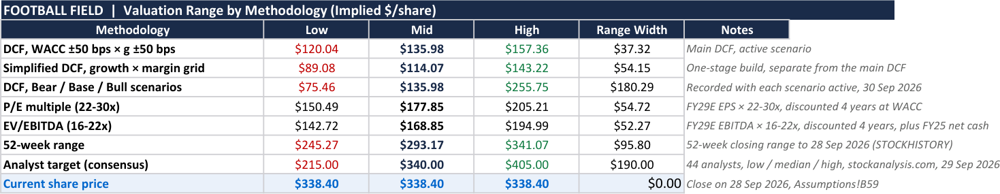
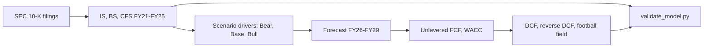
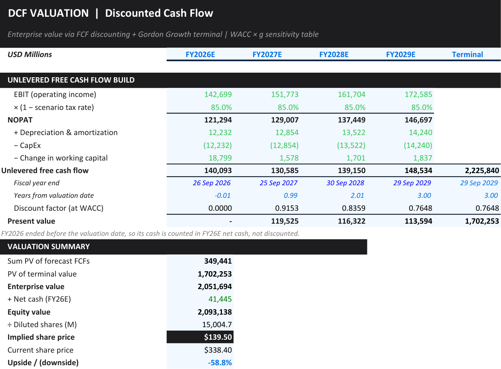
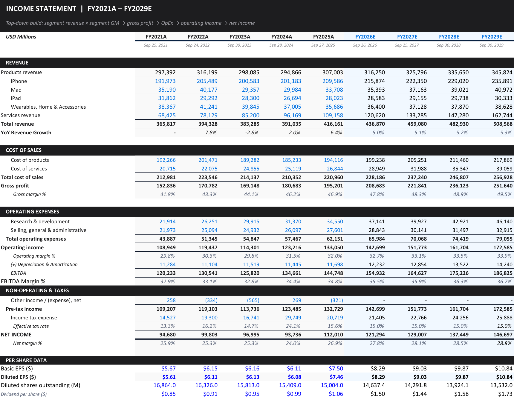
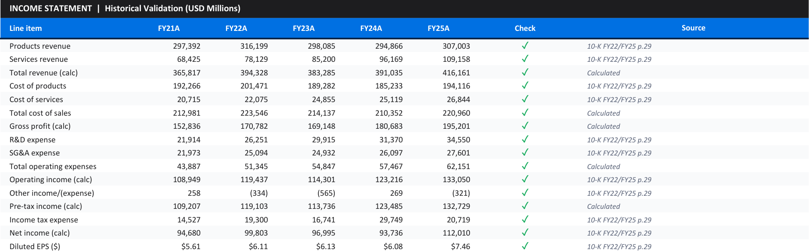

# Apple Valuation, Independently Checked

The DCF gives $139.50 a share against a $338.40 price; a separate program rebuilds every figure.

| At a glance | |
|---|---|
| **Who decides** | An investment or credit committee that needs a value it can defend. |
| **Result** | Base case $139.50 a share against a $338.40 price: the price implies about a 5.3% return on Apple's cash flows, against a 9.3% cost of capital. |
| **Proof** | Five years of SEC 10-K filings; a Python validator reconciles 20 of 20 accounting identities, 56 of 56 line items and 23 of 23 valuation figures; 20 tests, 14 of them injecting a fault. |

[](LICENSE)
[](https://www.microsoft.com/en-us/microsoft-365/excel)
[](https://github.com/alvenyuka/Financial-Analyst/actions/workflows/ci.yml)



## The problem

An investment or credit committee looking at a large listed company needs two things from a model: a value it
can defend, and the assumption that would have to change for the market price to be right. A spreadsheet that
reports "all checks pass" is computed by the same formulas it is meant to check, so the committee also needs
proof from outside the workbook. The question: **what are Apple's shares worth on its own filings, and what
does the market price imply?**

## How it works



1. **Historicals.** Transcribed from the 10-K filings and press releases, each line cited to a page. The filings
   for fiscal 2023 onward are in `Apple/Source_filings/`; fiscal 2021 and 2022 cite the fiscal 2022 and 2023
   10-Ks.
2. **Forecast** to fiscal 2029 from segment revenue growth and gross margins, operating-expense growth,
   working-capital days and capital returns, with no balancing plug: cash comes from the cash flow statement.
   One cell switches every driver between Bear, Base and Bull (`CHOOSE(MATCH(...))`).
3. **Inputs in one place.** Every assumption sits on the Assumptions sheet, in blue.
4. **Valuation.** Unlevered free cash flow is discounted at a CAPM-based WACC (cost of equity 10.0% at beta 1.1,
   after-tax cost of debt 3.4%, 90/10 weights) from the 28 Sep 2026 valuation date to each fiscal year-end, with
   a Gordon terminal value at the FY2029 year-end, two sensitivity grids and a football field. The reverse DCF
   solves for the discount rate at which the same cash flows justify the market price.
5. **Independent check.** `validate_model.py` reads the raw cells and recomputes every identity, line item,
   ratio and valuation figure outside Excel.

## Stack

| Layer | Tool | Version |
|---|---|---|
| Model | Excel workbook, no macros or add-ins; opens in LibreOffice Calc | |
| Validator | Python, openpyxl (reads cached formula results) | openpyxl 3.1 or later |
| Tests and CI | pytest with fault injection, GitHub Actions | Python 3.13 in CI |

## Results

A three-statement model and DCF of Apple, built in Excel from five years of SEC 10-K filings and rebuilt line by line by a separate Python validator. The model values the shares at $139.50 against a market price of $338.40; to justify that price, investors must accept about a 5.3% return on Apple's cash flows, against the 9.3% a standard cost-of-capital estimate gives. The validator reconciles 20 of 20 accounting identities, 56 of 56 transcribed line items and 23 of 23 valuation figures, and 20 tests, 14 of them injecting a fault, prove it catches errors.

- Five fiscal years of income statement, balance sheet and cash flow statement (FY2021 to FY2025), four
  forecast years, three scenarios.
- 20 tests pass; 14 of them break a copy of the model one cell at a time and prove the fault is caught.

| Apple, Base scenario | Value |
|---|---:|
| Enterprise value | $2.05tn |
| DCF implied share price | **$139.50** |
| Bear / Bull implied price | $75.86 / $265.54 |
| Terminal value share of enterprise value | 83% |

| Check (Apple, Base scenario) | Result |
|---|---:|
| Accounting identities reconciled | 20 of 20 |
| Transcribed line items traced to source cells | 56 of 56 |
| Valuation figures rebuilt independently | 23 of 23 |
| Ratios rebuilt from the traced line items, every year | 19 of 19 |

## Business impact

At $338.40 the market prices Apple far above what its forecast cash flows support at a standard cost of capital
(all figures printed by `validate_model.py`):

| Measure | Value |
|---|---:|
| Equity value, Base DCF | $2.09tn |
| Market value at $338.40 (15.0bn diluted shares) | $5.08tn |
| Premium the market pays over the Base case | **$2.98tn** |
| Discount rate the market price implies | **5.30%**, against 9.34% |
| Bull-case price against market | $265.54, 22% below |

At a 9.34% cost of capital the market price cannot be reached even in the Bull case. It is consistent with
investors accepting about a 5.3% return on Apple's cash flows, or with growth well above every scenario here.
For a committee, the useful output is not the $139.50 itself but which assumption would have to change to reach
the market price.

## Charts



*The DCF sheet: FY2026 ended two days before the valuation date, so its cash is counted in net cash rather than
discounted.*



*Products gross margin is held at its fiscal 2024-2025 average of 37%, while Services sits at 76% on a trend
rising about 1.4 points a year: Services margins drive the forecast.*



*Every historical line ticked against the 10-K page it came from.*

## Data

| Source | Link | Terms | Coverage | Date |
|---|---|---|---|---|
| Apple 10-K filings | SEC EDGAR, CIK 0000320193 | public filings | income statement, balance sheet, cash flow statement | fiscal 2021 to 2025 |
| Apple investor relations | press releases | public | segment revenue and gross margin (Products, Services) | fiscal 2021 to 2025 |
| Market data | | | close of $338.40; 52-week range $245.27 to $341.07 | 28 Sep 2026 |
| Analyst targets | stockanalysis.com | public page | 44 analysts, low $215, median $340, high $405 | 29 Sep 2026 |

## Key design decisions

- **Checked from outside the workbook.** The validator recomputes from raw cells rather than trusting the
  Validation tab. It has already paid for itself: an independent review found the cash flow statement reading
  each forecast year's working-capital movement from the year before, and net cash taken from the wrong year,
  while the workbook's own checks showed all green. Both are fixed, and the validator now rebuilds those
  figures from the balance sheet itself ([review history](docs/METHODOLOGY.md#review-history)).
- **Ratios rebuilt from traced line items.** Margins, growth, returns, debt ratios and cash conversion are
  recomputed from the same line items the filings were traced to, so a ratio pointing at the wrong cell fails.
- **No balancing plug.** Cash comes from the cash flow statement, so the balance sheet balances only if the
  three statements agree.
- **A reverse DCF alongside the DCF.** The terminal value is 83% of enterprise value, so the discount rate
  carries the valuation: a half-point change in WACC moves the price more than any forecast-year assumption.
  Solving for the rate the market implies makes that dependence explicit.
- **One scenario switch.** A single cell drives every assumption between Bear, Base and Bull, so scenarios
  cannot drift apart.

## Limits

- **Bear and Bull are recorded values**, saved with each scenario active; switching `B62` recalculates them.
- **Forecast drivers are assumptions.** The tax rate is the fiscal 2021-2025 average excluding fiscal 2024's
  one-off EU State Aid charge; the sanity bands on forecasts are wide, so passing them is a weak test.
- **One company.** Safaricom and Equity Group, both listed in Nairobi, are the next models.
- **The fiscal 2026 first-quarter statements** are in `Source_filings/` but not yet used.

## Project structure

The model's tabs and assumptions are described in [`Apple/README.md`](Apple/README.md) and the full method
in [`docs/METHODOLOGY.md`](docs/METHODOLOGY.md).


```
Apple/Apple_Financial_Model.xlsx   the model: assumptions, statements, DCF, validation tab
Apple/Source_filings/              the 10-K and press-release PDFs behind the historicals
Apple/README.md                    model-specific assumptions and tabs
validate_model.py                  independent validator (statements, ratios, valuation, reverse DCF)
tests/                             fault-injection tests for the validator
images/                            screenshots of the model
docs/METHODOLOGY.md                full method and the review history
```

## How to run

```bash
pip install -r requirements.txt
python validate_model.py      # rebuild the statements and the valuation, report the implied WACC
python -m pytest              # prove the validator catches injected faults
```

Or open `Apple/Apple_Financial_Model.xlsx` in Excel or LibreOffice Calc and change the scenario in cell `B62` of
the Assumptions sheet.

## Skills demonstrated

- Three-statement modelling from 10-K filings with no plug: `Apple/Apple_Financial_Model.xlsx`
- DCF with CAPM-based WACC, Gordon terminal value, sensitivity grids and a football field: the DCF sheet
- Reverse DCF to read the market's implied discount rate: `validate_model.py`
- Scenario modelling with one switch cell: the Assumptions sheet
- Independent model validation and fault-injection testing: `validate_model.py`, `tests/`
- Source tracing of every historical line to a filing page: the Validation tab

## License

MIT. See [`LICENSE`](LICENSE). Sources: SEC EDGAR filings (CIK 0000320193), Apple investor relations, and
stockanalysis.com for the analyst range.

Alven Yuka · [LinkedIn](https://www.linkedin.com/in/alven-yuka-610b78174/) · [Email](mailto:alvenyuka2@gmail.com)
